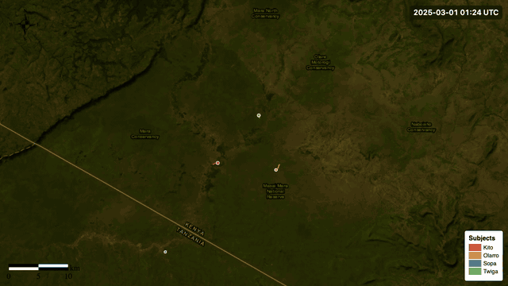

# Animate Subject Tracks Workflow

Turns an EarthRanger subject group's GPS history into an animated 3D map: each subject's track sweeps across real terrain as time passes. The same animation can optionally be exported as an MP4 video.



Full documentation: **[wildlife-dynamics.github.io/animate-subject-tracks](https://wildlife-dynamics.github.io/animate-subject-tracks/)** (User Guide, Technical Guide and Troubleshooting).

## What it produces

- An **interactive animated 3D map** (`animated_map.html`). Each subject is drawn as a trail in its EarthRanger colour, with a marker at its current position, over a basemap of your choice (satellite imagery by default) draped on 3D terrain. It has a playback bar, map buttons (zoom, compass, reset view, fullscreen), a legend of subject names, and a **Camera panel** for designing how the camera moves.
- An optional **MP4 video** (`animation.mp4`) of the same animation, recorded with the same camera the map plays with. Video export is off by default.
- **GeoParquet files** of the cleaned relocations and trajectories, for further analysis.
- A **dashboard** showing the animated map, with the workflow details and time range, and a **Files** section for downloading the map and the video.

## Requirements

- An **EarthRanger connection** configured in the workflow runner.
- A **subject group** in EarthRanger, e.g. `Elephants`. Every subject in the group gets its own track.
- Internet access while the workflow runs and while you view the map. Terrain elevation tiles (AWS Terrarium) and basemap imagery (Esri ArcGIS Online) are fetched live.

> Longer time ranges and larger subject groups take longer to fetch and, if video export is on, to record as video. For a first run, a range of a few days to a few weeks works well.

---

## 1. Load the Workflow

In the workflow runner, go to **Workflow Templates** and click **Add Workflow Template**. Paste this repository's URL into the **Github Link** field, then click **Add Template**:

```
https://github.com/wildlife-dynamics/animate-subject-tracks.git
```

Once added, the workflow appears in the **Workflow Templates** list. Click it to open the configuration form.

> The card may show **Initializing…** briefly while the environment is set up.

---

## 2. Configure the Workflow

Only the **Workflow Name**, **Data Source**, **Time Range** and **Subject Group Name** need to be filled in. Every other section is pre-filled with defaults and can be left alone on a first run. Fields marked *advanced* are collapsed on the form.

### Workflow Details

| Field | Description |
|-------|-------------|
| Workflow Name | A short name to identify this run, e.g. `Elephants – July 2026` |
| Workflow Description | Optional notes about the run |

### Connect to EarthRanger

| Field | Description |
|-------|-------------|
| Data Source | The EarthRanger connection to pull tracking data from |

### Time Range

| Field | Description |
|-------|-------------|
| Since | Start of the period to animate |
| Until | End of the period to animate |
| Timezone | Optional timezone for Since/Until |
| Time Format *(advanced)* | How times are displayed on the dashboard. Default `%d %b %Y %H:%M:%S` |

### Subject Group

| Field | Description |
|-------|-------------|
| Subject Group Name | The EarthRanger subject group to animate, picked from a drop-down of the subject groups on the chosen Data Source. A group with mixed subject subtypes can give unexpected results. |

### Trajectory Segment Filter *(advanced)*

Removes GPS noise by dropping track segments whose length, duration or speed falls outside these limits. The defaults suit most terrestrial wildlife.

| Field | Default |
|-------|---------|
| Min / Max length | `0.001` m / `100 000` m |
| Min / Max time | `1` s / `172 800` s (2 days) |
| Min / Max speed | `0.01` km/h / `500` km/h |

### Terrain

Controls how the 3D terrain looks and how the tracks sit on it.

#### Terrain Exaggeration *(advanced)*

| Field | Default | Description |
|-------|---------|-------------|
| Exaggeration | `1.0` | Vertical scale of the 3D terrain. `1.0` is true scale; `2.0` doubles apparent heights, which helps on flat landscapes. The tracks are raised to match. |

#### Terrain Sampling *(advanced)*

**Track height** sets where the tracks are drawn. The choices follow Google Maps 3D's altitude modes, and each shows only its own setting:

| Option | Setting | What it does |
|--------|---------|--------------|
| Above the ground *(default)* | Height `30` m | Tracks float a set height above the ground |
| On the ground | — | Tracks lie on the ground; any recorded altitude is ignored |
| Recorded altitude (where available) | Height without an altitude `30` m | Each fix at its recorded altitude above sea level. Fixes without one (usual for EarthRanger data) sit the set height above the ground instead of at sea level. |
| Above the 3D terrain | Height `30` m | A set height above the terrain *as drawn on the map*, so tracks, markers and labels stay on the surface at every zoom |

Tracks also get an extra point every 150 m, so lines follow ridges and valleys between fixes instead of cutting through hills.

#### Basemap

| Field | Default | Description |
|-------|---------|-------------|
| Basemap | Satellite | Map imagery draped over the 3D terrain, in both the interactive map and the video |
| Place names | Off | Adds place names and boundaries (Esri World Boundaries and Places) over the basemap |

| Basemap option | Description |
|--------|-------------|
| Satellite *(default)* | Esri World Imagery aerial and satellite photos, sharp to about 0.6 m a pixel when zoomed in |
| Terrain | Esri World Topographic Map, with contours, roads and place names |
| Roadmap | Esri World Street Map |
| USGS Hillshade | Esri World Hillshade, a grey shaded-relief map that emphasises landforms |

The basemap is given a natural colour look (slightly richer and warmer) and a soft vignette. Tracks and markers keep the colours shown in the legend.

### Map Zoom & Extent *(advanced)*

The map opens centred and zoomed to fit every track. These two fields set the viewing angle, which the cameras also use.

| Field | Default | Description |
|-------|---------|-------------|
| Pitch | `45` | Tilt in degrees (0–90). `0` looks straight down; higher values tilt towards the horizon for a 3D view. |
| Bearing | `0` | Rotation in degrees clockwise from north (−180 to 180). `90` puts east at the top. |

### Animation

Controls how the tracks animate on the map, and how the camera moves.

#### Create Animation *(advanced)*

**Marker icon** sets what is drawn at each subject's current position:

| Option | Description |
|--------|-------------|
| Dot *(default)* | A flat circle in the subject's colour with a white outline |
| 3D animal | A ready-tuned 3D model: elephant, giraffe, cheetah, leopard or lion, coloured by the subject's track and lit by the sun |

#### Playback Control *(advanced)*

| Field | Default | Description |
|-------|---------|-------------|
| Position | Bottom | Whether the playback bar sits at the bottom or top of the map |
| Show Camera | On | The camera button on the playback bar, which opens the Camera panel |
| Show map buttons | On | Zoom in/out, compass, back to the opening view, fullscreen, and a spinner while the map loads |

The playback bar always has play/pause, restart, a time slider, the playback clock (e.g. `0:12 / 0:30`), the data date and time, and a speed button (0.25× to 4×).

#### Playback Length & Smoothness *(advanced)*

| Field | Default | Description |
|-------|---------|-------------|
| Duration | `30` s | How long playback takes from the first location to the last. The video uses the same length by default. |

#### Camera

| Field | Default | Description |
|-------|---------|-------------|
| Camera settings | A fixed view of the whole scene | Settings copied from the map's **Camera panel** (or the path of its downloaded `.json` file). The interactive map plays with this camera, and so does the video. |

To set a camera:

1. Run the workflow once and open the animated map.
2. Click the **camera button** on the playback bar, pick a camera and adjust it. Press play to preview it; **Use current view** fills in the centre, distance, tilt and heading from wherever you've moved the map.
3. Click **Copy settings** (or **Download**), paste them into **Camera settings**, and run the workflow again.

| Camera | What it does |
|--------|--------------|
| Fixed view | Holds one view for the whole clip; blank values frame the whole scene |
| Fly to & around | Flies in from the whole scene, then circles a point (blank = the centre of the data) |
| Follow a subject | Stays behind one subject, facing where it is heading (blank = the longest-running track) |
| Subject tour | Follows each subject in turn, flying between them, with each subject's name shown as the camera reaches it |
| Follow the action | Frames the recent movement of all subjects (or the ones you list), re-fitting as they move and spread |
| Cinematic fly-through | Opens on the whole scene, flies in to the action, then follows it with a tilted camera that slowly turns |
| Keyframes | Flies through waypoints you add in the panel, upload as a file (`.json`, `.geojson`, `.csv` or `.tsv` with lon/lat), or derive from a subject's track |

The following cameras (Follow a subject, Subject tour, Follow the action, Cinematic fly-through) move smoothly and also offer **Lead room** (space ahead of moving subjects), **Zoom with the action** (in while subjects rest, out while they travel fast) and **Keep in view over hills** (the camera rises when a ridge would hide what it follows).

### Video Export

Exports the animation as an MP4 video. **Video export is off by default**, so only the interactive map is produced.

#### Include video?

| Field | Default | Description |
|-------|---------|-------------|
| Export video | Off | Turn on to also render the animation as an MP4 video. Recording a video makes the workflow take longer to run. |

#### Video Settings *(advanced)*

These settings only apply when **Export video** is on. The video uses the camera set in **Animation → Camera**.

| Field | Default | Description |
|-------|---------|-------------|
| Duration | Auto | **Auto** matches the animation's playback length. Uncheck it to set a fixed length in seconds. |
| Overlays | All on | The date and time (and which corner it sits in), legend, north arrow, scale bar, title and marker labels |
| Resolution | 720p | 720p, 1080p or 4K landscape, 720p or 1080p vertical (9:16), 1080p square (1:1), or a custom width and height |

---

## 3. Run the Workflow

Click **Submit**. The workflow fetches the observations, cleans them into trajectories, drapes them on the terrain and builds the animated map. If **Export video** is on, it then records the video frame by frame in a headless browser; otherwise that step is skipped.

When it's on, recording the video is usually the slowest step. The default settings give 900 frames (30 seconds at 30 fps). Higher resolutions and longer durations take proportionally longer.

---

## 4. Outputs

All files are written to the workflow's results folder (`ECOSCOPE_WORKFLOWS_RESULTS`). On ecoscope-web this is cloud storage; the video is recorded locally and uploaded there.

| File | Description |
|------|-------------|
| `animated_map.html` | The interactive animated 3D map, shown on the dashboard as **Subject movements** |
| `animation.mp4` | H.264 video of the animation. Only written when **Export video** is on. |
| `relocations_<hash>.geoparquet` | Cleaned GPS fixes |
| `trajectories_<hash>.geoparquet` | Trajectory segments after the segment filter |

The dashboard shows the **Subject movements** map with the workflow name, description and time range. Its **Files** section lists `animated_map.html` and, when exported, `animation.mp4`.

---

## 5. Troubleshooting

| Symptom | Likely cause |
|---------|--------------|
| No tracks appear | The subject group has no fixes in the time range, or the wrong group or data source was picked |
| A track is broken into disconnected pieces | The Trajectory Segment Filter is dropping segments as noise; loosen its limits if your data has long gaps or unusual speeds |
| No `animation.mp4` in the results | Video export is off by default. Turn on **Video Export → Export video** and run again. |
| The map plays with a fixed view, not my camera | Paste the Camera panel's settings into **Animation → Camera** and run again. On the map, **Preview camera while playing** turns off when you move the map; turn it back on in the Camera panel. |
| Trails float above or sink into the terrain | Change **Terrain → Terrain Sampling → Track height**: lower its Height, or pick **Above the 3D terrain** to keep tracks on the surface as drawn |
| The run takes a long time | A wide time range, a large group, or a long/high-resolution video. Turn video export off, or try 720p and a shorter duration first. |
| The 3D animal doesn't appear | Check the **Marker icon** setting. The model loads from GitHub, so the viewer needs internet access; a dot is shown if it can't load. |

More in the [Troubleshooting guide](https://wildlife-dynamics.github.io/animate-subject-tracks/troubleshooting.html).

---

## Development

- **Recompile** after changing `spec.yaml`:
  ```
  pixi run --manifest-path pixi.toml --locked bash -c "./dev/recompile.sh --update"
  ```
- **Test** with fake data (four collars in the Maasai Mara; no EarthRanger needed):
  ```
  bash dev/pytest-cli.sh animate_tracks --all
  ```
  The test cases are in `test-cases.yaml`. The fake observations in `dev/mock-io/` are made by `dev/make_mock_observations.py`.
