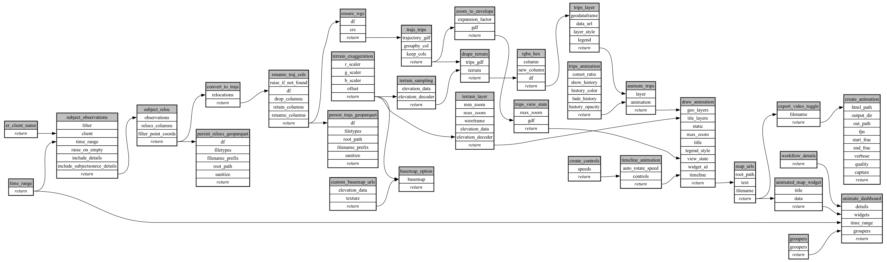

```
# AUTOGENERATED BY ECOSCOPE-WORKFLOWS; see fingerprint in README.md for details

```

```yaml
# fingerprint:
artifacts_sha256_basic: bc7fcf8dccdf4d4af9f4cfebc74425ef7ef6ed1af665cb2df00db304c8b6fa6f
artifacts_sha256_strict: 6c5f1ded215c2cbabe59f20a28e612ae183d0e92737066e3b6a802437afeea38
installed_requirements:
- channel: https://repo.prefix.dev/ecoscope-workflows/
  name: ecoscope-platform
  version: {version: ==2.15.1}
- channel: https://repo.prefix.dev/ecoscope-workflows-custom/
  name: ecoscope-workflows-ext-custom
  version: {version: ==0.1.0rc14}
- channel: https://repo.prefix.dev/ecoscope-workflows-custom/
  name: ecoscope-workflows-ext-ste
  version: {version: ==0.0.0rc1}
- channel: https://repo.prefix.dev/ecoscope-workflows-custom/
  name: ecoscope-workflows-ext-mep
  version: {version: ==1.0.4}
- channel: conda-forge
  name: pydeck
  version: {version: ==0.9.2}
- channel: conda-forge
  name: opentelemetry-sdk
  version: {version: ==1.45.1}
params_sha256: d2c8e78310028c752b242db04e476cd12dbe16c7dab8a16b99f26923176c5d80
spec_sha256: da633b1e3ed93f1ae0e2332cd8317aff15e9a4a6766fe471feeff58252e175d5

```

# ecoscope-workflows-animate-tracks-workflow


