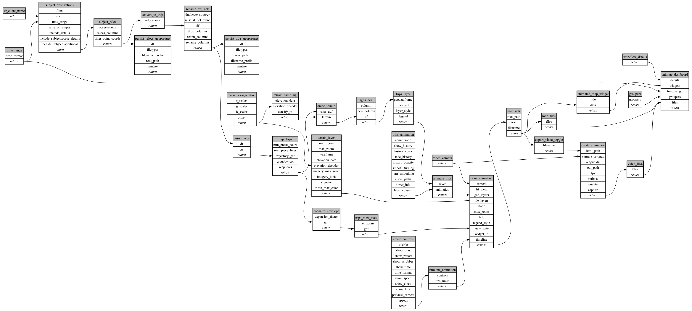

```
# AUTOGENERATED BY ECOSCOPE-WORKFLOWS; see fingerprint in README.md for details

```

```yaml
# fingerprint:
artifacts_sha256_basic: b268eba46227633ae82f5ee5534bf635364df9f8a39e81b855c1218bedf33b43
artifacts_sha256_strict: 04993be2c39cb8533352d1fb1d3ff59d7c39720b77ae6d1214ad17f0022beef8
installed_requirements:
- channel: https://repo.prefix.dev/ecoscope-workflows/
  name: ecoscope-platform
  version: {version: ==2.25.3}
- channel: https://repo.prefix.dev/ecoscope-workflows-custom/
  name: ecoscope-workflows-ext-custom
  version: {version: ==0.1.5}
- channel: https://repo.prefix.dev/ecoscope-workflows-custom/
  name: ecoscope-workflows-ext-ste
  version: {version: ==0.0.32}
- channel: https://repo.prefix.dev/ecoscope-workflows-custom/
  name: ecoscope-workflows-ext-mep
  version: {version: ==1.10.9}
- channel: conda-forge
  name: pydeck
  version: {version: ==0.9.2}
- channel: conda-forge
  name: opentelemetry-sdk
  version: {version: ==1.45.2}
params_sha256: 6f49a7b445b35bdf04eb0415bd15d750700ee7437dc6990cc8263c515176870d
spec_sha256: 9a6cda3aaf246cf125a1487ed7f392f5e6bbf7a5bff5f3a83974a824bea9b454

```

# ecoscope-workflows-animate-tracks-workflow


