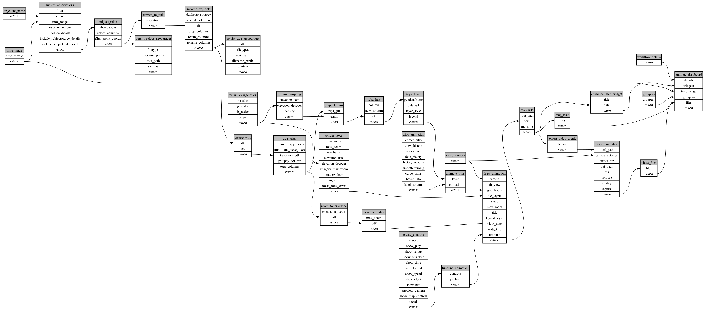

```
# AUTOGENERATED BY ECOSCOPE-WORKFLOWS; see fingerprint in README.md for details

```

```yaml
# fingerprint:
artifacts_sha256_basic: b390e3a99ac56eb2cef87ca1a91e43abd1d61fc096046c63306d82e16f43744d
artifacts_sha256_strict: bafa3a0417e524e1aa52ad496111802fc5f5a217958c605de01e7a0d03e30ade
installed_requirements:
- channel: https://repo.prefix.dev/ecoscope-workflows/
  name: ecoscope-platform
  version: {version: ==2.40.0}
- channel: https://repo.prefix.dev/ecoscope-workflows-custom/
  name: ecoscope-workflows-ext-custom
  version: {version: ==0.2.1}
- channel: conda-forge
  name: pydeck
  version: {version: ==0.9.2}
- channel: conda-forge
  name: opentelemetry-sdk
  version: {version: ==1.45.2}
params_sha256: 9c069fb3b6457bfed0aced102206a58bf5e70a5eb23d3382b458ab5b3a5c0c2b
spec_sha256: bc2f66c15bea5b9b80904d36f405bc1ee444f748cf328048da119fced35edcb9

```

# ecoscope-workflows-animate-tracks-workflow


